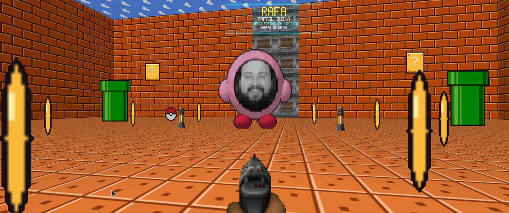
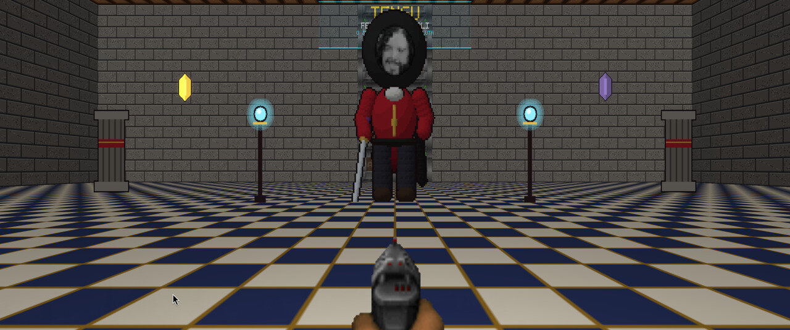
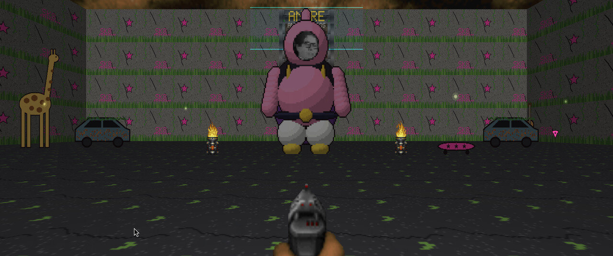
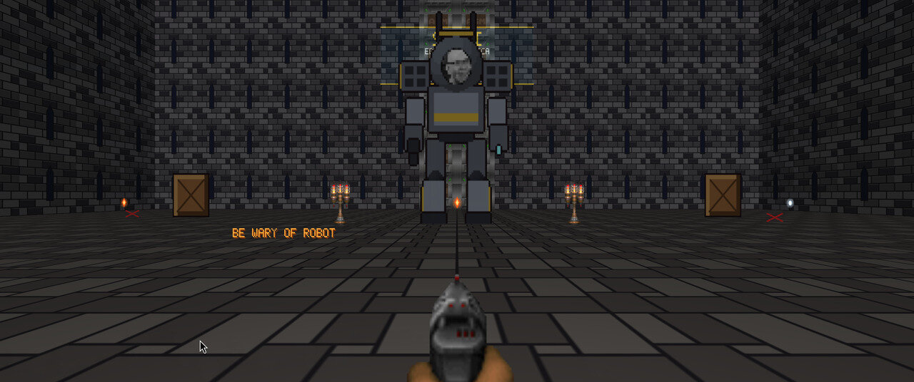
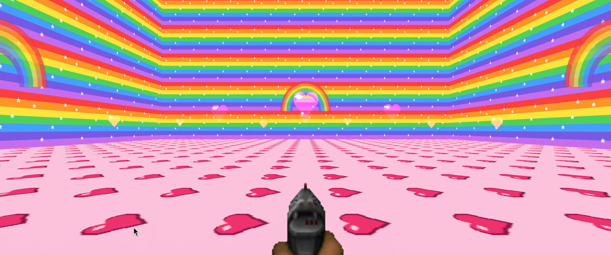
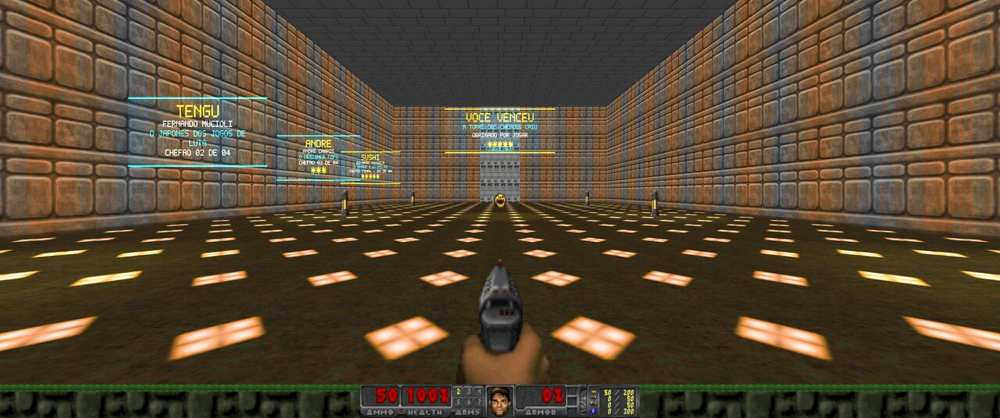
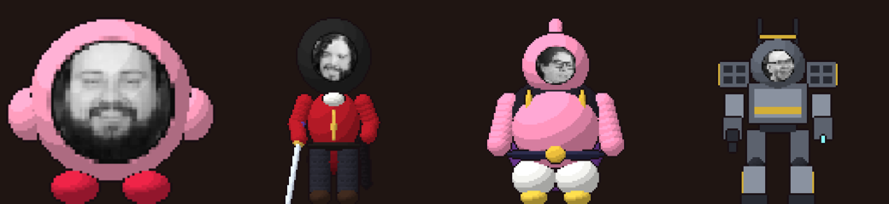
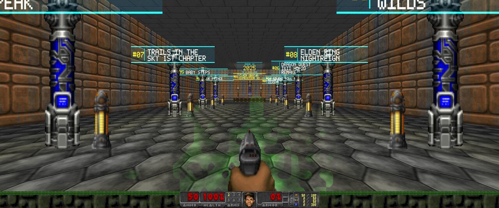

# Jogabilidoom

Museu de jogos em formato de mapa para Doom. O PWAD para **GZDoom** é uma torre:
uma escadaria central sobe **um andar por ano** e, em cada patamar, uma porta de
teleporte leva ao salão do Top 10 daquele ano do Jogabilidade. Acima do último
ano a torre continua: **quatro arenas de chefe**, uma por integrante do podcast,
com progressão travada, e no topo a câmara do troféu, onde o mapa termina.

> **Versão beta.** O jogo ainda está em desenvolvimento: os chefes, as arenas e
> o equilíbrio das lutas ainda vão mudar. Downloads, instruções e o changelog de
> cada versão: **<https://blog.profevine.com.br/jogabilidoom/>**

## Como jogar

O passo a passo completo, com instalação no Windows, no Linux e no macOS e
solução de problemas comuns, está em **[INSTALAR.md](INSTALAR.md)**. O resumo:

### Windows: pacote pronto

Baixe o pacote para Windows na [página do jogo](https://blog.profevine.com.br/jogabilidoom/)
ou na [página de versões](https://github.com/profevine/jogabilidoom/releases).
Ele já traz o GZDoom e o Freedoom, então não precisa instalar nada:

1. Extraia o zip inteiro para uma pasta (não rode de dentro do zip).
2. Dê dois cliques em `JOGAR.bat`.
3. Se o Windows avisar que protegeu o computador, clique em *Mais informações* e
   depois em *Executar assim mesmo*.

### Linux, macOS ou quem já tem o GZDoom

São três peças: o motor **GZDoom** (ou o UZDoom, o sucessor), um **IWAD** e o
`jogabilidoom.wad` (baixado da página do jogo ou gerado com o build abaixo).

- GZDoom: <https://zdoom.org/downloads> ou o gerenciador de pacotes da distribuição.
- IWAD: o [Freedoom: Phase 2](https://freedoom.github.io/download.html)
  (`freedoom2.wad`, gratuito e livre) ou o `doom2.wad` original.

```bash
gzdoom -iwad freedoom2.wad -file jogabilidoom.wad +map MAP01
```

No macOS: `open -a GZDoom --args -iwad "$PWD/freedoom2.wad" -file "$PWD/jogabilidoom.wad" +map MAP01`.

Para abrir o jogo digitando só `jogabilidoom` no terminal, um atalho no
`~/.bashrc` (ou `~/.zshrc`), com os caminhos ajustados:

```bash
alias jogabilidoom='gzdoom -iwad ~/Jogos/freedoom2.wad -file ~/Jogos/jogabilidoom.wad +map MAP01'
```

**Controles:** os do GZDoom. `W A S D` anda, o mouse mira, o botão esquerdo atira,
`E` ou `Espaço` usa. As alcovas dos patamares são teleportes: é só atravessar a
soleira.

## Importar as listas

As listas vêm da planilha pública [Os Melhores do Ano do Jogabilidade
2016-2025](https://docs.google.com/spreadsheets/d/1Pn0UWUDnKS0O_lA4KNvk7nDRbUIqWOibAWX1vVjH1AQ/edit), organizada por Renato Mesquita, baixada como `.xlsx`
(`…/export?format=xlsx`):

```bash
node tools/import-top10.mjs /caminho/para/jogabilidade-top10.xlsx
```

O comando reescreve [`data/museum.json`](data/museum.json) com uma sala por ano.
A coluna da lista coletiva muda de aba para aba (ela só ganha o cabeçalho
"TOP 10" a partir de 2022), então o mapeamento por ano fica explícito no topo do
script. Anos com menos de dez colocações aparecem como aviso no terminal.

## Gerar o mapa

Requer Node.js 18 ou mais recente:

```bash
node tools/build-wad.mjs
```

O comando gera `jogabilidoom.wad` na raiz do projeto. Esse arquivo é derivado
e, por isso, não entra no Git. O gerador valida a geometria antes de escrever:
cada setor precisa ser um contorno fechado, com as paredes viradas para dentro.

Para jogar o que acabou de gerar, use o comando de [Como jogar](#como-jogar).

## Como o museu é montado

- O jogador nasce no saguão, no pé da escadaria.
- A escadaria sobe **72 unidades por ano**, em lances de três degraus. O andar 01
  é o de 2016; o último é o do ano mais recente da planilha.
- Cada patamar tem uma alcova iluminada com um totem (`ANDAR 07 / 2022`).
  Atravessar a soleira teleporta para o salão daquele ano, que fica na mesma
  altura do patamar.
- O salão se lê da porta para o fundo: quem entra encontra primeiro as **duas
  últimas colocações** (10 e 9), uma de cada lado do corredor, e sobe a lista de
  par em par — 8 e 7, 6 e 5, 4 e 3. Em ano com dez colocações o vice sobra
  sozinho, ao lado do pódio.
- O **primeiro lugar** fica sozinho no pódio: um degrau iluminado no centro da
  parede do fundo, entre dois holofotes, com a placa em dourado e maior que as
  outras. O totem do ano paira logo acima dele.
- Cada altar tem uma placa holográfica suspensa com a posição e o nome do jogo —
  sprites PNG gerados pelo próprio build e embutidos no PWAD.
- A alcova do salão devolve o jogador ao mesmo patamar da escadaria.
- O lump `JOGINFO` guarda a listagem completa em texto, ano a ano.

## A torre dos chefes

Acima do último ano a escadaria continua e a torre tem mais cinco andares:
**quatro arenas** e a **câmara do troféu**. Cada arena é de um integrante atual
do Jogabilidade, na ordem de subida, e a última é a do chefe final.

| Andar | Chefe | Corpo | Tema da arena | Comportamento herdado | Vida |
|---|---|---|---|---|---|
| 11 | Rafa | bolinha rosa | Nintendo | Cacodemon | 900 |
| 12 | Tengu | espadachim de katana | Trails | Hell Knight | 1200 |
| 13 | André | majin rosa | The Last of Us + Avril Lavigne | Arch-Vile | 1400 |
| 14 | Sushi (chefe final) | mecha | Souls + quebra-cabeças | Cyberdemon | 4000 |
| 15 | — | câmara do troféu | — | — | — |

- Cada arena é uma **caixa fechada**: chega-se pela alcova do patamar (teleporte)
  e a única saída é o portão do fundo. O portão é uma porta clássica do Doom com
  o teto no chão e **sem special na linha** — o jogador não abre na mão.
- Quem abre o portão é o próprio chefe, ao morrer: os estados do chefe chamam
  `Door_Open` no tag do setor do portão (é a mesma mecânica do Keen no Doom II)
  e ainda avisam no console (`RAFA DERROTADO!`).
- Atrás do portão, a soleira do vestíbulo teleporta para o patamar do andar
  seguinte. Só depois do Sushi o jogador chega ao andar 15.
- Na câmara do troféu ficam a placa `VOCE VENCEU`, os créditos dos quatro e o
  interruptor de parede que **encerra o mapa** (o `MAPINFO` manda para o
  `EndGameC`).
- O arsenal de cada andar fica no patamar, antes de entrar: escopeta no 11,
  super escopeta no 12, lança-foguetes no 13, plasma e BFG no 14. Dentro da
  arena há munição, vida e armadura para aguentar a briga.
- Tudo isso é dados: [`data/bosses.json`](data/bosses.json) tem o monstro
  base, vida, velocidade, o corpo, o tema da arena (`wall`, `floor`, `ceiling`,
  `light`, `height`, `tema`) e o sprite (`rosto`: `escala`, `raio`, `cor`), além
  do arsenal e dos suprimentos de cada chefe. Mudar o número e rodar o build de novo basta para
  reequilibrar uma luta.

## Como os chefes são desenhados

O chefe não é um monstro do IWAD com um rosto colado por cima: o **sprite
inteiro é desenhado pelo build**. Cada corpo é montado com elipsoides, cápsulas
e caixas e renderizado por um ray tracer pequeno em `tools/build-wad.mjs`, em
**8 ângulos** (quando o chefe vira, o corpo vira junto), com sombreado em
degraus e contorno, para ficar com cara de pixel art. A caixa de colisão
acompanha o sprite, então o que se vê é o que se acerta.

- Só o **comportamento** vem do monstro clássico herdado: o Cacodemon cospe a
  bola de plasma, o Hell Knight parte para cima, a Arch-Vile queima e o
  Cyberdemon dispara foguetes. As animações e os ataques especiais são nossos.
- As caras saem das fotos do [media kit do
  Jogabilidade](https://midiakit.jogabilida.de/) e ficam em
  [`data/rostos/`](data/rostos/) (`rafa.png`, `tengu.png`, `andre.png`,
  `sushi.png`), já reduzidas a pixel art e projetadas na frente da cabeça.
- Para trocar por outra foto, é só substituir `data/rostos/<id>.png` (120×120,
  PNG RGBA, sem entrelaçamento) e rodar `node tools/build-wad.mjs`.

## O Rafa: bolinha rosa, arena Nintendo e o golpe de sugar

Em `data/bosses.json`, três campos mudam o Rafa sem afetar os outros chefes:

- `"corpo": "kirby"`: o corpo é uma bolinha rosa de pés vermelhos com o rosto
  na frente, montada com elipsoides e renderizada pelo próprio build (um ray
  tracer pequeno) em **8 ângulos**. Quando ele vira, o corpo vira junto; de
  costas só aparece o rosa. A morte é ele murchando até virar uma panqueca.
- `"tema": "nintendo"` na arena: paredes de tijolo, chão de bloco e céu com
  nuvens (texturas próprias em `TX_START`), canos no lugar dos pilares, blocos
  "?" flutuando, anel de moedas e itens temáticos: moeda (bônus de vida),
  cogumelo (medikit) e estrelinha (bônus de armadura).
- `"especial": "sugar"`: às vezes, com o jogador a menos de 700 unidades, ele
  suga em vez de atirar (3 s, com partículas). Quem chega na boca é engolido e
  vai para a **dimensão dos corações** (sala fechada a leste das arenas, tag
  250); 6 s depois ele cospe o jogador na frente dele, com a **vida cheia**. O
  golpe tem 12 s de descanso e, enquanto suga, ele não sente dor. As ações
  ficam no lump `ZSCRIPT` (classe `JogSugador`, que herda o Cacodemon).

## O Tengu: espadachim de Trails

- `"corpo": "espadachim"`: um espadachim baixinho de uniforme vermelho de
  academia militar, calça escura e katana, com o rosto do Tengu na cabeça.
  Usa o mesmo ray tracer do Rafa (braços, pernas e lâmina são cápsulas de
  esferas), em 8 ângulos. Ele ergue a katana e corta: de perto é golpe, de
  longe sai uma onda de corte em meia-lua (`JogCorte`). Na morte ele ajoelha e
  cai de lado.
- `"tema": "trails"`: salão de pedra com piso xadrez e teto de madeira,
  estandartes vermelhos, um brasão, colunas de pedra no lugar dos pilares,
  postes de luz orbal no lugar das luminárias, quartzos flutuando nas sete
  cores dos elementos e um cristal azul gigante num canto. Os itens viram
  sepith (bônus de vida e de armadura) e Teara Balm (medikit).
- Os temas ficam na tabela `THEMES` de `tools/build-wad.mjs`: o que entra no
  lugar dos pilares e das luminárias, os enfeites, a troca de itens, as
  texturas, os sprites e os atores de cada um.

## O André: majin em ruínas pop-punk

- `"corpo": "majin"`: gorducho rosa ao estilo do Majin Boo, com anteninha,
  colete preto de friso dourado, calça branca bufante, botas douradas, capa
  roxa e o rosto do André. Herda o Arch-Vile, mas o fogo dele é rosa
  (`JogFogoRosa`). O ataque usa as letras C, D, L e J (e K na cura), para não
  bater com a dor (E) e a morte (F..I), em que ele derrete numa poça rosa.
- `"tema": "tlou"`: ruínas de concreto com musgo e trepadeiras, asfalto
  rachado e céu aberto; carros enferrujados como cobertura, barris em chamas,
  a girafa, vaga-lumes, um violão e o toque da Avril: pichação rosa com
  estrelas, a placa "SK8" e um skate rosa. Itens: suplementos (bônus de vida),
  palheta rosa (bônus de armadura) e kit médico (medikit).

## O Sushi: mecha numa catedral Souls

- `"corpo": "mecha"`: robô ao estilo Armored Core, montado com caixas (o ray
  tracer também desenha caixas, com `box: true`), cor grafite com detalhes na
  cor do Sushi, lançadores de mísseis nos ombros, rifle, lâmina de luz azul,
  mochila de propulsores e o rosto dele na cabine. Herda o Cyberdemon; na
  morte desmonta em sucata pegando fogo.
- `"tema": "souls"`: catedral gótica escura com a fogueira da espada
  espiralada, a névoa na entrada, candelabros e uma mensagem laranja no chão;
  caixas de Sokoban como cobertura, com os alvos em X, e um quadro de Picross
  resolvido (um sushi) na parede norte. Itens: alma (bônus de vida), brasa
  (bônus de armadura) e frasco de Estus (medikit).

## A torre em imagens

Capturas do mapa rodando com o `freedoom2.wad` (os sprites e texturas do Doom
são os do Freedoom; com o `doom2.wad` valem os originais):

| Andar 11 — o Rafa na arena Nintendo | Andar 12 — o Tengu no salão de Trails |
|---|---|
|  |  |

| Andar 13 — o André nas ruínas | Andar 14 — o Sushi na catedral |
|---|---|
|  |  |

| A dimensão dos corações (golpe do Rafa) | Andar 15 — a câmara do troféu |
|---|---|
|  |  |

Os quatro chefes, como o build os desenha (Rafa, Tengu, André e Sushi):



| Andar 10 — o salão de 2025, no museu |
|---|
|  |

## Trilha sonora

A música do mapa é uma **faixa própria em MIDI** — o formato que o Doom toca
nativamente — montada em cima do **encerramento das lives do Jogabilidade**.
Ela não é uma cópia: a faixa original é de terceiros e não existe publicada (os
vídeos do canal creditam "Música Original: ElevenWAV" e "Música Incidental:
HOME"), então o que foi feito aqui foi transcrever o trecho gravado e recriar a
música no sintetizador do jogo.

O que veio da transcrição do trecho (`tools/analyze-music.mjs` /
[`tools/transcribe-music.mjs`](tools/transcribe-music.mjs)):

- andamento **105 BPM**, 8 compassos de 4/4;
- progressão **Bm | C | Am | D | Em | C | Am | D**;
- a **linha de baixo colcheia por colcheia** de cada compasso;
- a textura: baixo pesado, acorde sustentado e batida eletrônica.

O que é invenção (um trecho de 20 s de uma mixagem densa não entrega tudo): o
desenho do lead — aqui um arpejo dos próprios acordes, que nunca briga com a
harmonia —, os arranjos das seções intermediárias, os fills e a virada final. A
faixa tem 48 compassos (~1min50) e volta ao começo emendada, para repetir sem
corte.

```bash
node tools/make-music.mjs     # gera data/music.mid (determinístico)
node tools/build-wad.mjs      # embute como lump D_JOGA
```

O gerador é determinístico: a mesma semente, o mesmo arquivo. Para ouvir fora do
jogo dá para renderizar com o próprio ffmpeg (`ffmpeg -i data/music.mid
previa.wav`), mas o som que vale é o do GZDoom — ele usa o soundfont em
`/opt/gzdoom/soundfonts/gzdoom.sf2`.

**Se você preferir o áudio da gravação original**, é só colocá-lo em
`data/music.ogg` (ou `mp3`, `flac`, `mod`, `it`, `xm`, `wav`): esses arquivos
têm prioridade sobre o MIDI. O atalho é:

```bash
node tools/import-music.mjs "<video ou audio>" --loop-crossfade 1.5
```

O comando extrai o áudio (de um arquivo ou de um link, com `yt-dlp`), normaliza
a altura (EBU R128), emenda o fim no começo para repetir sem clique e grava
`data/music.ogg` — só precisa de `ffmpeg` no PATH.

## Como verificar sem jogar

O build valida a geometria antes de escrever o PWAD (todo setor precisa ser um
contorno fechado), e o GZDoom carrega o mapa com `-norun` para conferir lumps,
texturas e scripts:

```bash
node tools/build-wad.mjs
gzdoom -iwad /caminho/para/freedoom2.wad -file jogabilidoom.wad -norun
```

## Pendências

1. **2016 e 2017 estão incompletos**: a planilha tem só 7 e 8 colocações na
   lista coletiva. O mapa monta os salões com o que existe; falta conferir os
   episódios para completar as posições que faltam.
2. `index.html` ainda é o protótipo em three.js com os anos antigos; ele não
   acompanha o `data/museum.json` nem a torre dos chefes.
3. **As quatro lutas ainda não passaram por um playtest de verdade**: o
   balanceamento (vida, velocidade e munição) ainda é estimado. Os números estão
   todos em `data/bosses.json`, fáceis de ajustar depois de uma primeira rodada.
4. **Áudio dos chefes**: cada um ainda vai ganhar falas e sons próprios.

## Créditos

- **Renato Mesquita**, que organizou a planilha [Os Melhores do Ano do
  Jogabilidade 2016-2025](https://docs.google.com/spreadsheets/d/1Pn0UWUDnKS0O_lA4KNvk7nDRbUIqWOibAWX1vVjH1AQ/edit) com os Top 10 de todos os anos. É dela que
  saem os salões do museu.
- **O Jogabilidade** e seus integrantes, que viraram os chefes da torre:
  **Rafael Quina** (Rafa), **Fernando Mucioli** (Tengu), **André Campos** e
  **Eduardo Fonseca** (Sushi). Os Top 10 são deles, e os rostos dos chefes vêm do
  [media kit](https://midiakit.jogabilida.de/) público do podcast.
- **GZDoom** (<https://zdoom.org>) e **Freedoom** (<https://freedoom.github.io>),
  o motor e os gráficos e sons base do pacote para Windows.

## Sobre

O Jogabilidoom é um trabalho independente, feito por fãs como homenagem ao
[Jogabilidade](https://jogabilida.de/). Não tem vínculo com o podcast nem com
seus integrantes, e não é endossado por eles. É gratuito e sem fins comerciais.
Nomes, marcas e imagens pertencem aos seus donos; Doom é marca da id Software, e
o Freedoom é um projeto livre à parte.
